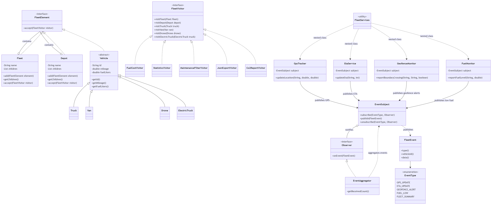

# Fleet Logistics System

## 1. Project Overview

This project implements a simple Fleet Logistics System using Java and Maven. The application manages a fleet of vehicles, calculates operating costs, generates reports, and processes fleet events.

The project demonstrates object-oriented programming, software design patterns, and basic concurrent event processing.

## 2. Technologies Used

- Java
- Maven
- JUnit 5
- IntelliJ IDEA
- Mermaid and draw.io for UML documentation

## 3. Design Patterns

### Composite Pattern

The Composite pattern represents the fleet as a tree structure. A Fleet can contain depots, and a Depot can contain vehicles. Both composite objects and vehicles implement the common FleetElement interface.

This allows the application to process the fleet hierarchy through a common interface.

### Visitor Pattern

The Visitor pattern separates operations from the fleet object structure. Visitors perform different operations without placing all this logic inside the vehicle classes.

The project includes:

- FuelCostVisitor — calculates fuel costs.
- StatisticsVisitor — counts vehicles and calculates total mileage.
- MaintenanceFilterVisitor — identifies vehicles that require maintenance.
- JsonExportVisitor — exports fleet information as JSON lines.
- Co2ReportVisitor — calculates estimated CO2 emissions.

The visitors support trucks, vans, drones, and electric trucks.

### Observer Pattern

The Observer pattern is used to publish and receive fleet events. EventSubject publishes events to registered observers, and EventAggregator collects event information.

The supported event types include GPS updates, ETA updates, geofence alerts, low-fuel alerts, and fleet summary events.

## 4. Fleet Services

The FleetServices class contains four services connected to the event system:

- GpsTracker — publishes vehicle location updates.
- EtaService — publishes estimated arrival time updates.
- GeofenceMonitor — reports when a vehicle enters or exits a zone.
- FuelMonitor — publishes a low-fuel event when the fuel percentage is below 20%.

These services use EventSubject to publish events.

## 5. Concurrency

The application uses Java's ExecutorService to process events from multiple tasks. The event system uses concurrent-friendly collections to support event publication and observer management.

The application waits for the submitted tasks to finish and shuts down the executor.

## 6. Project Structure

## 6. Project Structure

The project structure is organized as follows:

- assignment6sdp — the root project directory.
- pom.xml — Maven configuration file.
- README.md — project documentation.
- FleetLogisticsUML.drawio.png — UML class diagram image.
- src/main/java/fleetlogistics/FleetModel.java — fleet, depot, and vehicle classes.
- src/main/java/fleetlogistics/ObserverSystem.java — event system and observer pattern.
- src/main/java/fleetlogistics/Visitors.java — visitor implementations for reports and calculations.
- src/main/java/fleetlogistics/FleetServices.java — GPS, ETA, geofence, and fuel monitoring services.
- src/main/java/fleetlogistics/FleetLogisticsApp.java — main application entry point.
- src/test/java/fleetlogistics/FleetLogisticsTest.java — automated tests.

## 7. UML Diagram

The UML class diagram illustrates the fleet hierarchy, visitor implementations, event system, and fleet services.

## 8. How to Run

1. Open the project in IntelliJ IDEA.
2. Make sure Maven dependencies are loaded.
3. Run FleetLogisticsApp.main().
4. Review the fleet report and event output in the console.

## 9. How to Run Tests

Run the tests using Maven:

mvn test

The tests verify the fleet model, visitor calculations, maintenance filtering, JSON export, CO2 calculations, and event processing.

## 10. Conclusion

This project demonstrates how the Composite, Visitor, and Observer design patterns can be used together in a fleet management application. It also demonstrates service integration, concurrent event processing, reporting, and automated testing.
